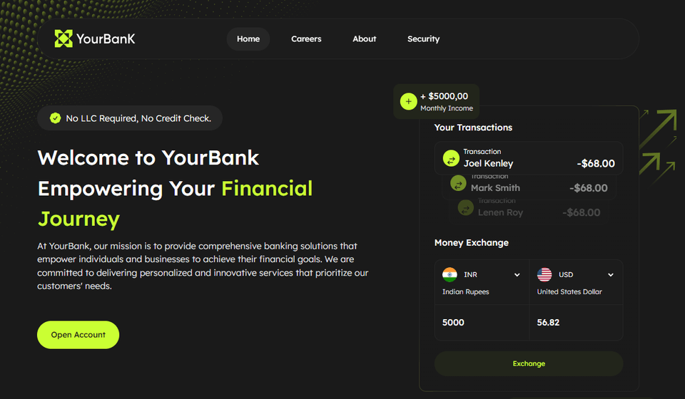

# YourBank

🏦 A responsive multi-page bank website built with HTML, CSS, vanilla JavaScript, Vite and Handlebars partials.

**[▶ Open the demo](https://banking-coral-three.vercel.app)**



A bank website of four pages, built from a third-party design template and written without a UI framework. The pages are assembled at build time from Handlebars partials and data files, and every interaction is a small object-oriented class: one per component and one per section. It keeps production habits from larger projects: a Vite build with optimised images and minified HTML, size budgets, CI, linting hooks, accessibility, and search and link-preview metadata.

## ✨ Features

- Four pages (Home, Careers, About, Security) matching the 1920, 1440 and 390px design and fluid down to 320px
- A currency converter in the hero: fixed rates in `src/data/`, native selects, an amount field and a swap button
- Products and Testimonials toggles (For Individuals, For Businesses) and tabs for the Features
- A testimonials carousel on CSS scroll-snap, with arrow buttons
- An FAQ with a preview under a fade and a Load All expander
- Cross-fade page transitions (cross-document View Transitions) and reveal on scroll, both off for reduced motion
- Accessible: skip link, focus rings, 44px hit areas, keyboard support, no axe violations on any page
- Link previews with an Open Graph image, `robots.txt`, `sitemap.xml`, `llms.txt` and JSON-LD
- Optimised AVIF and WebP images, a preloaded self-hosted font, minified HTML and hashed assets cached for a year
- An unknown address answers with the home page and a 404 status

## 📈 Lighthouse

Measured on production with Lighthouse 13.5.0, the best of several runs:

| Page     | Device  | Performance | Accessibility | Best Practices | SEO |
| -------- | ------- | ----------- | ------------- | -------------- | --- |
| Home     | Mobile  | 100         | 100           | 100            | 100 |
| Home     | Desktop | 100         | 100           | 100            | 100 |
| Careers  | Mobile  | 100         | 100           | 100            | 100 |
| Careers  | Desktop | 100         | 100           | 100            | 100 |
| About    | Mobile  | 100         | 100           | 100            | 100 |
| About    | Desktop | 100         | 100           | 100            | 100 |
| Security | Mobile  | 100         | 100           | 100            | 100 |
| Security | Desktop | 100         | 100           | 100            | 100 |

Mobile Performance varies between 98 and 100 from run to run.

## 🧰 Tech Stack

- HTML
- CSS (native nesting, design tokens)
- JavaScript (ES modules)
- Vite 8
  - vite-plugin-handlebars (Handlebars partials)
  - vite-plugin-image-optimizer (sharp and SVGO)
- html-minifier-terser
- ESLint
- Stylelint
- Prettier
- Husky
- lint-staged
- size-limit
- GitHub Actions
- Vercel
- npm

## 📁 Project Structure

```text
src/
  index.html, careers.html, about.html, security.html   The four pages: each lists its partials
  partials/
    sections/
      shared/        Head, header, footer, page hero, FAQ, call to action
      home/          Hero, products, use cases, features, testimonials
      careers/       Values, benefits, job openings
      about/         Mission and vision, press releases
      security/      How We Protect You
    components/      Repeated elements: cards, badges, FAQ item, currency converter, carousel
  data/              The content and settings the partials render: currency rates, products, FAQ, jobs, site
  scripts/
    main.js          The only entry: finds each section's root, creates its controller, starts it
    constants.js     Media queries, data hooks, texts, state classes
    components/      Tabs, Toggle, Disclosure, CurrencyConverter, Carousel, Reveal
    controllers/     One class per section: header menu, products, features, FAQ, testimonials, footer
  styles/
    style.css        CSS entry, imports the rest
    general/         Reset, font face, tokens and fluid ramps, page base
    ui/              Button, toggle, reveal, hit area, visually hidden
    components/      One stylesheet per component partial
    sections/        One stylesheet per section partial
  assets/
    fonts/           Self-hosted Lexend (woff2)
    images/          Logo, page photos, icons, flags and dotted decor
public/              Files with a fixed URL, copied as they are: favicon, link preview image, robots.txt, sitemap.xml, llms.txt
vite/                Vite config in parts: paths, build options, plugins, Handlebars context and helpers
vercel.json          Clean URLs and the cache header of the hashed assets
assets/              The demo GIF shown above
ai/                  Agent docs: repo map, rules, decisions, skills, prompts, plans
```

## 🚀 Scripts

Install dependencies, which also installs the pre-commit hook (needs Node.js 20.19+ or 22.12+):

```bash
npm install
```

Run the development server at <http://localhost:5173>:

```bash
npm run dev
```

Build the production version into `dist/`, with `404.html` as a copy of the home page:

```bash
npm run build
```

Preview the production build locally (run `npm run build` first):

```bash
npm run preview
```

Lint the JavaScript (`npm run lint:fix` also fixes what it can):

```bash
npm run lint
```

Lint the CSS (`npm run lint:css:fix` also fixes what it can):

```bash
npm run lint:css
```

Format the code with Prettier (`npm run format:check` only checks):

```bash
npm run format
```

Check the bundle sizes against their budgets (run `npm run build` first):

```bash
npm run size
```

## 🔄 CI

Every push runs [GitHub Actions](.github/workflows/ci.yml): lint, CSS lint, format check, build, and the size budgets from [`.size-limit.json`](.size-limit.json).

The pre-commit hook (Husky and lint-staged) runs ESLint, Stylelint and Prettier on the staged files.

`main` deploys to Vercel production through its Git integration; other branches get previews.

## 🧱 Architecture Notes

- Vanilla JavaScript, Vite and Handlebars partials: no framework, no TypeScript ([decision](ai/decisions/2026-10-23-vanilla-js-vite-handlebars.md))
- Sources live in `src/`: partials grouped by page, content in `src/data/`, every asset bundled and hashed ([decision](ai/decisions/2026-10-23-sources-in-src.md))
- A class per component and per section, created and started in `main.js` ([decision](ai/decisions/2026-10-23-oop-javascript.md))
- Two breakpoints and fluid values on ramps between the three drawn widths ([decision](ai/decisions/2026-10-25-fluid-ramps.md))
- Currency rates are fixed data, with no API and native selects ([decision](ai/decisions/2026-10-24-fixed-rates-native-select.md))
- The carousel is CSS scroll-snap with no library ([decision](ai/decisions/2026-10-24-carousel-scroll-snap.md))
- Page transitions are cross-document View Transitions in CSS, with no router ([decision](ai/decisions/2026-10-26-cross-document-view-transitions.md))
- Reveal on scroll is opt-in and never hides the first screen ([decision](ai/decisions/2026-10-24-reveal-on-scroll.md))
- The 404 page is a build-time copy of the home page ([decision](ai/decisions/2026-10-26-vercel-json-dev-clean-urls.md))
- Four pages, no automated tests, by design ([decisions](ai/decisions/README.md))

## 🤖 AI Workflow

The site is built and maintained by AI agents (Claude Code) under the author's review. Everything they need lives in the repo, written for any agent rather than one tool:

| Part                                      | What it gives an agent                                                    |
| ----------------------------------------- | ------------------------------------------------------------------------- |
| [`AGENTS.md`](AGENTS.md)                  | The entry point: project defaults and the rules that never bend           |
| [`ai/map.md`](ai/map.md)                  | Where every page, partial, style, script and data file lives              |
| [`ai/rules/`](ai/rules)                   | How to write the code and the docs, and the Definition of Done            |
| [`ai/decisions/`](ai/decisions/README.md) | Why things are the way they are, so nothing settled gets "fixed" back     |
| [`ai/skills/`](ai/skills/README.md)       | Playbooks: adding a page section, self-review                             |
| [`ai/prompts/`](ai/prompts/README.md)     | Session prompts: one task, or an orchestrator running several in parallel |
| [`ai/superpowers/`](ai/superpowers)       | The plan (and spec) of every past task                                    |

Every change follows [one workflow](ai/workflow.md): a Linear issue → a plan → the code on its own branch → checks and a run in the browser → self-review → the author's approval → a local merge into `main`.
